# 生成と検証から考えるテスト自動化の歴史とコスト構造

## 1. 生成の高速化と検証のボトルネック

生成AIの登場によって、ソフトウェア開発における生成作業は高速化しました。

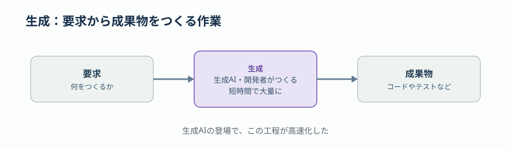

しかし、生成した成果物が要求を満たしているかを確認する検証作業は、生成と同じ割合で高速化したとは限りません。生成量が増えるほど検証対象も増え、検証が開発全体の制約になる場合があります。

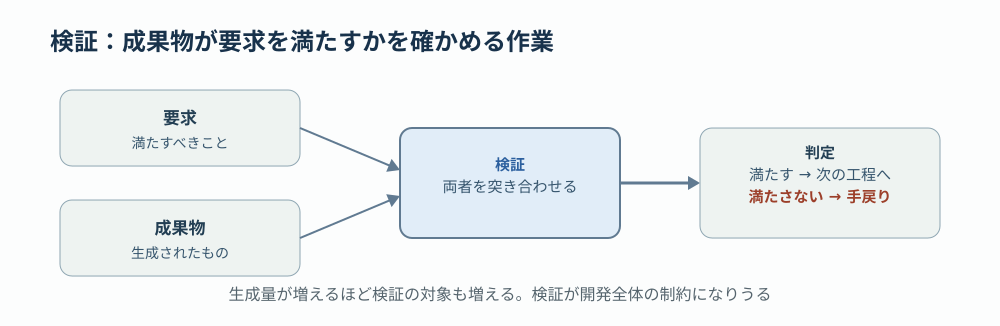

重要なのは、**生成の高速化と開発全体の生産性向上は同義ではない**という点です。開発全体の効果を評価するには、生成、検証、手戻り、環境維持まで含めて考える必要があります。

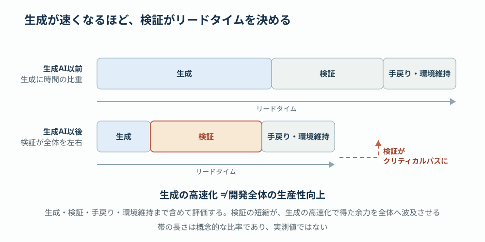

一方で、**生成コストが低下した分、検証の効率化が開発全体の生産性に与える効果への期待は高まっています。**

## 2. 検証の分解：静的検証と動的検証

検証は、実行を伴わない静的検証と、実際にソフトウェアを動かす動的検証に大別できます。

| 区分 | 方法 | 主な対象・手段 | 残る判断 |
| --- | --- | --- | --- |
| 静的検証 | 実行を伴わない調査 | 要件・設計のレビュー、型チェック、静的解析、コードレビュー | 仕様の妥当性、設計判断の正しさ |
| 動的検証 | 実行による振る舞いの確認 | 単体テスト、APIテスト、画面テスト、性能テスト | 期待結果の正当性、テストの十分性 |

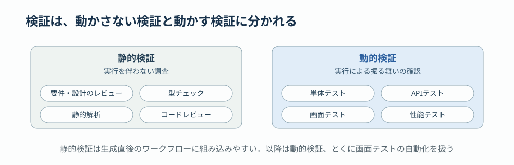

静的検証は、生成直後のワークフローに組み込みやすい性質があります。一方、動的検証には、実行環境、テストデータ、操作手順、期待結果、証跡の取り扱いが必要です。

動的検証はさらに、次の活動に分解できます。

1. **テスト設計**：何を確かめるか
2. **テスト実装**：どう確かめるか
3. **テスト実行**：実際に動かす
4. **結果判定**：正しいか比較する
5. **原因分析・保守**：失敗の原因を調べ、必要な修正を行う

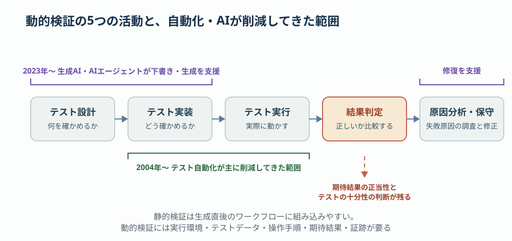

長い間、テスト自動化が重点的に削減してきたのは、主にテスト実装とテスト実行の作業です。この変化を、画面テストの歴史から振り返ります。

## 3. 画面テスト自動化の歴史

| 時期 | 転換点 | 主に改善したもの | 残った課題 |
| --- | --- | --- | --- |
| 2004年〜 | Seleniumによるブラウザ操作の自動化 | 操作の反復実行 | スクリプトの作成・保守 |
| 2006年〜 | Selenium IDEによる記録・再生 | テスト実装の入口 | SUT変更への追従、複雑なケースへの対応 |
| 2008〜2013年 | Sauce Labs、BrowserStackなどのクラウド実行環境 | ブラウザ・OSの実行環境管理 | テスト設計・実装・運用の調整 |
| 2017〜2020年 | ノーコード型テスト自動化SaaSの展開 | テストの作成・実行・管理・保守の統合 | 業務知識、期待結果、対象環境の制約 |
| 2020〜2022年 | 自動化事例の蓄積と生産性効果の公表・先例化 | 導入効果の定量化と横展開 | 初期費用・保守費を含めた効果の再現性 |
| 2023〜2024年 | 生成AIによるテストケース・コード作成支援 | テスト設計・実装の下書き | 生成結果の妥当性、実行基盤の維持 |
| 2025年〜 | AIエージェントによる計画・生成・実行・修復の連携 | テスト活動の複数工程を横断 | 継続運用、品質判断、検証の独立性 |

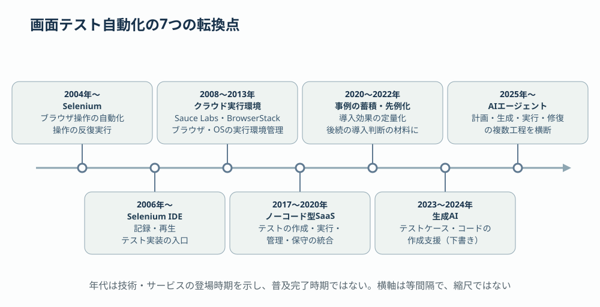

2004年にSeleniumが始まり、2006年には日本の笠谷真也氏によるSelenium IDEが登場しました。BrowserStackは2011年に一般公開され、2013年にクラウド上でSeleniumテストを実行するAutomateを投入しました。Autifyは2019年にノーコード型製品を正式公開しました。[1][2][3]

2020〜2022年は、ノーコード型SaaSなどの導入事例が、生産性向上やテスト工数削減といった定量的な効果とともに共有され、後続の導入判断に利用できる先例として蓄積されていった時期として位置づけます。

ROIの考え方自体がこの時期に生まれたわけではありません。また、各事例の削減率は対象範囲や運用条件に依存するため、別案件への適用には構築費・保守費を含む再評価が必要です。

2025年には、Playwright 1.56でPlanner・Generator・Healerの3種類のTest Agentsが導入されました。アプリケーション探索からテスト計画、コード生成、失敗テストの修復までを連携させる考え方が、具体的な製品機能になっています。[4]

## 4. テスト自動化が生むもう一つのシステム：TASとSUT

テスト自動化のコストを理解するには、ISTQBで用いられる次の区別が役立ちます。

- **SUT（System Under Test）**：テスト対象のシステム。業務アプリケーションなど
- **TAS（Test Automation System）**：テストを自動実行・制御するシステム。テストスクリプト、実行制御、結果取得などを含む

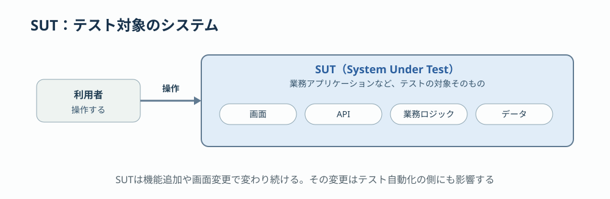

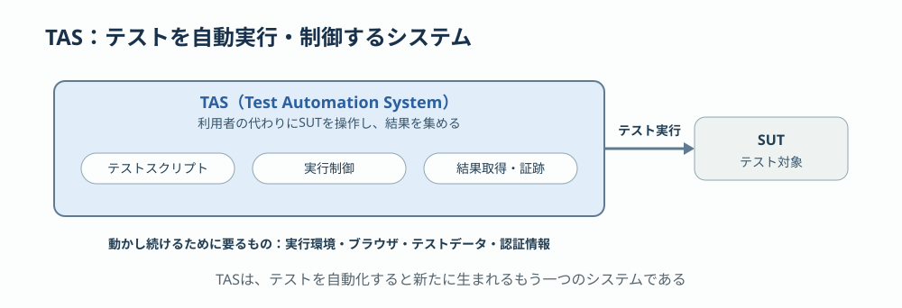

SUTに機能追加や画面変更があると、TAS側のテストも変更が必要になる場合があります。

さらにTAS自身にも、ライブラリ更新、ブラウザのバージョン変更、テストデータ整備、実行環境の障害対応が発生します。

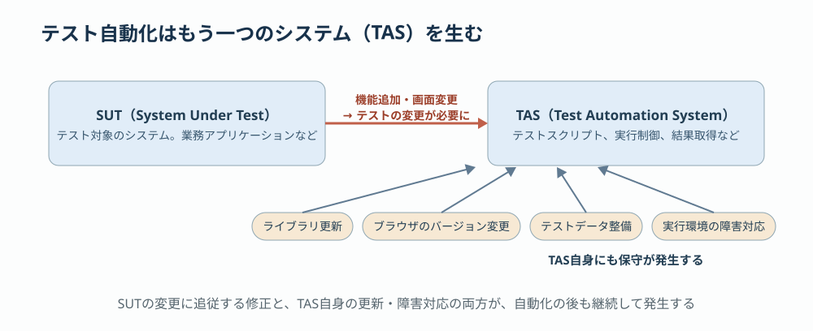

したがって、**人手によるテスト実行の削減は、TASを構築・保守する新しい負担と交換されている**と考えられます。

自動化の価値は、この交換が経済的に成立するかどうかで決まります。

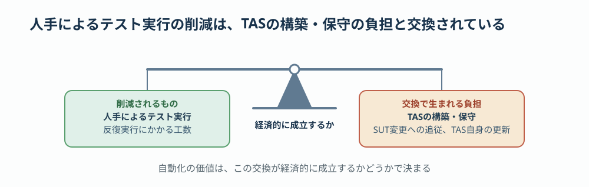

## 5. TASの構築・保守コストの変遷

Seleniumの初期には、操作スクリプトも実行環境も自社で準備する負担がありました。Selenium IDEはテストの作成負担を減らしましたが、画面変更に伴う修正は残りました。

クラウド実行環境は、ブラウザやOSを用意して維持する負担の一部をサービス提供者へ移しました。ただし、テストの作成・期待結果の定義・業務データの準備まで一括で解決するわけではありませんでした。

ノーコード型SaaSはさらに、テスト作成、実行スケジュール、実行結果・証跡、テスト修復などを一体的に提供しました。

これにより、**テストを動かし続けるための仕組みそのものを自社で作る負担**を減らせるようになりました。[5]

生成AIとAIエージェントは、主にテスト設計・コード生成・修復に必要な作業を削減します。しかし、その削減は必ずしもCI/CD基盤の構築・保守負担の削減を意味しません。

| TASのコスト要素 | ノーコード型SaaSの主な効果 | AIエージェント＋Playwrightの主な効果 |
| --- | --- | --- |
| テスト設計・ケース作成 | GUI・AI支援による軽減 | 仕様・アプリ探索からの案の生成 |
| テストコード作成 | 手書きコードへの依存の低減 | コード生成・修正の支援 |
| 実行環境 | クラウド実行環境の利用 | 別途準備・運用が必要 |
| 定期実行・証跡 | 製品標準機能の利用 | CI/CD設定・レポート連携が必要 |
| テスト修復 | 製品の保守機能の利用 | エージェントによる修復支援 |
| SUT固有の期待結果・データ | 利用者側に判断・整備の責任が残存 | 利用者側に判断・整備の責任が残存 |
| 費用 | 継続的なサービス利用料 | 開発・計算資源・基盤運用費 |

この表は代表的な構成の比較です。製品の契約プランや、既存のCI/CD基盤によって実際の費用負担は変わります。

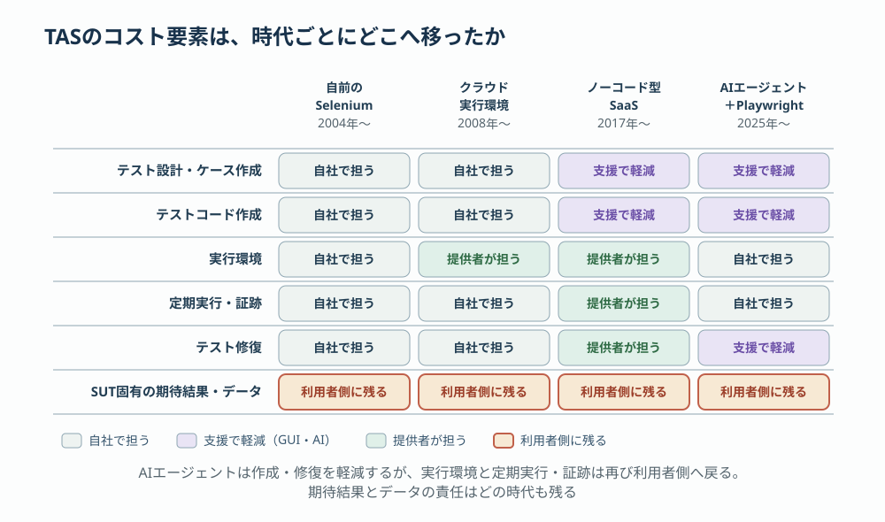

## 6. ノーコード型SaaSの本質的な強み

ノーコード型SaaSの本質的な価値は、コードを書かずにテストを作れることに加え、**TASの実行・保守・管理の責任をサービス提供者へ移せる範囲が広いこと**にあります。

例えばMagicPodは、クラウド上での実行、スケジュール実行、結果ログ、通知、テストの自動修復などを提供しています。

利用者はそれらの仕組みを個別に組み合わせて構築する必要を減らせます。[5]

ただし、責任がすべて移るわけではありません。

テスト対象の仕様の理解、期待結果の定義、テストデータ・アカウントの準備、テストの十分性判断は、引き続き開発・テスト組織に残ります。

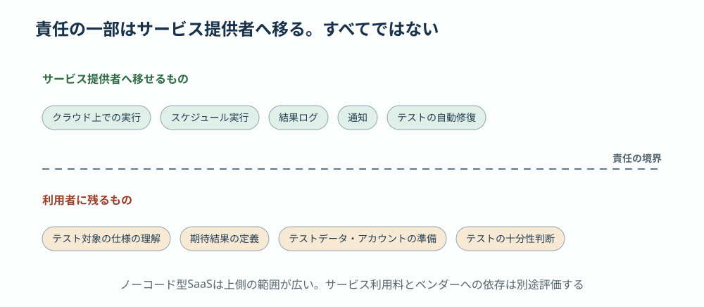

また、サービス利用料やベンダーへの依存も評価が必要です。

## 7. AIエージェントによる構築費低減とCI/CD運用の壁

AIエージェントを使えば、Playwrightのテストシナリオやスクリプトの生成・修復を短時間で行えるようになります。

これはTASの**作成部分**のコストを下げる変化です。

しかし、継続的にテストを動かすためには、次の運用要素が残ります。

- CI Runnerの構築・管理
- ブラウザや依存パッケージの準備・更新
- 認証情報・アクセス権限の管理
- テスト実行対象環境の準備
- テストデータの初期化・管理
- 実行結果・証跡の保存
- 実行失敗時の原因調査
- 障害発生時の復旧・再実行

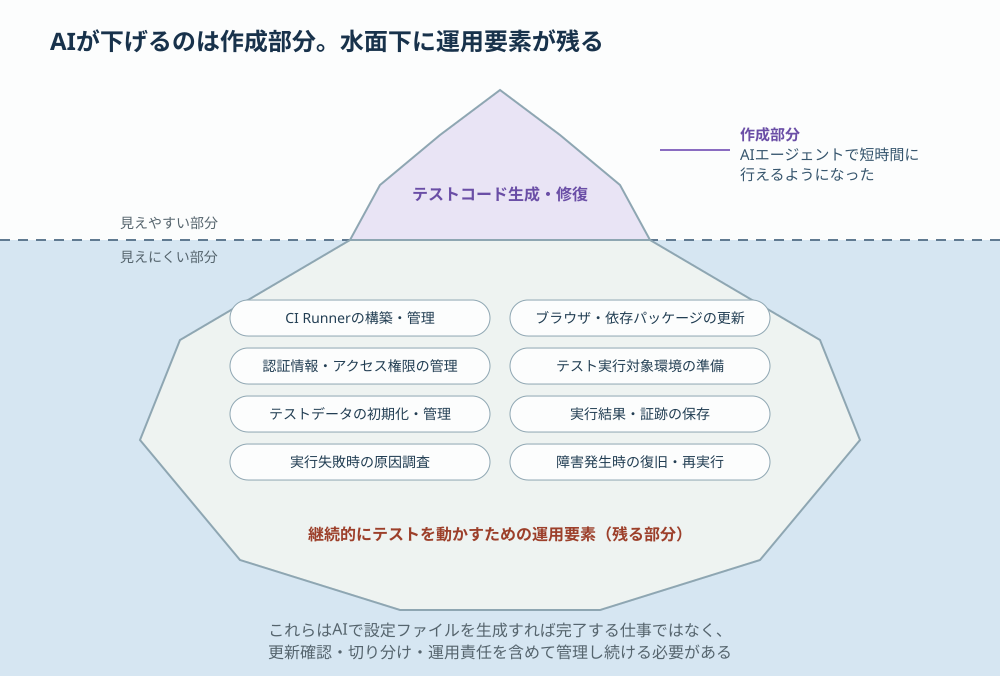

Playwrightの公式CIガイドでも、ブラウザ実行可能な環境の用意、依存関係の導入、テスト実行、レポート保存などを扱っています。[6]

これらはAIで設定ファイルを生成すれば完了する仕事ではありません。

バージョン更新時の確認や、実行失敗時の切り分け、運用責任の割り当てまで含めて継続的に管理する必要があります。

特に、**組織としてCI/CDの成熟度が十分に高まっていない場合、Playwright＋CI/CDの構築・保守コストは依然として高くなります。**

例えば、案件ごとにRunnerを立てる、標準構成がない、パイプラインの失敗を診断できる人が限られる、といった状態では、テストコードの自動生成だけでは運用負荷を十分に減らせません。

これはPlaywright自体の欠点というより、既存の開発基盤と組織能力によってテスト自動化の経済性が左右される問題です。

逆に、共通CI/CD基盤と運用チームがすでに存在する組織では、Playwrightの追加コストを低く抑えられます。

## 8. 2022年にMagicPodによるE2Eテスト自動化を推進した理由

2022年から、SaaSであるMagicPodを用いたE2Eテスト自動化施策を推進した背景には、個別のツール性能だけでなく、SI企業の案件構成と開発基盤の実情がありました。

判断の狙いは、限られた専門人材で、多様な既存案件に横展開できる検証効率化策を選ぶことでした。

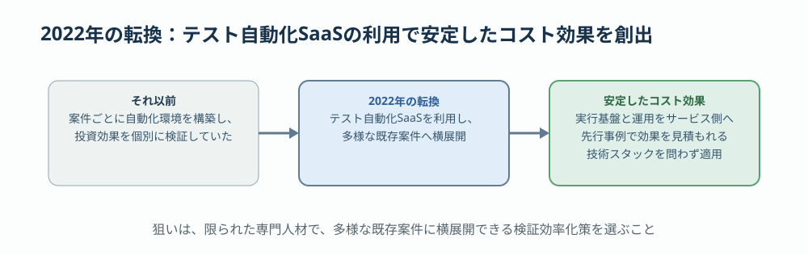

### 8.1. 先行事例の存在

2022年時点では、SaaS型テスト自動化の導入事例と効果がすでに一定数公開されていました。

それ以前のテスト自動化では、個々の案件で自動化環境を構築し、投資効果を検証する必要がありました。

一方、SaaS型サービスについては、他社の導入事例や工数削減効果を参考に、自社案件への適用可能性を検討できる状況になっていました。

先行事例が存在することは、導入効果の保証ではありません。しかし、新たな技術の実証から始める場合と比べて、導入判断の不確実性を減らす材料になりました。

### 8.2. 保守開発中心の案件構成

保守開発案件が約8割を占めるSI企業では、ホワイトボックステストの改善施策を全社横断で適用することが容易ではありません。

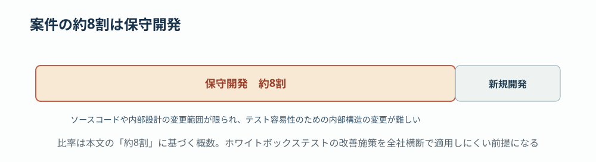

保守開発では、次の制約があります。

- ソースコードや内部設計の変更範囲の制限
- 既存のアーキテクチャやフレームワークへの依存
- 開発プロセスやテスト基盤の変更に対する制約
- 既存システムの技術的負債
- テスト容易性を考慮した内部構造への変更の難しさ

例えば、単体テストの自動化を強化する場合、依存関係の分離やテスト容易性を考慮したコードの改善が必要になることがあります。

しかし、既存システムの内部構造を自由に変更できない案件では、こうした施策を適用しにくいという問題があります。

### 8.3. 技術スタックに依存しにくい汎用性

画面E2Eテストは、SUTの内部実装ではなく、利用者から見える画面操作とその結果を検証します。

そのため、次のような技術構成の違いを超えて適用できます。

- JSPによるサーバーサイドレンダリング
- SPAによるクライアントサイドレンダリング
- JavaScriptを多用するWebアプリケーション
- 既存のレガシーWebアプリケーション

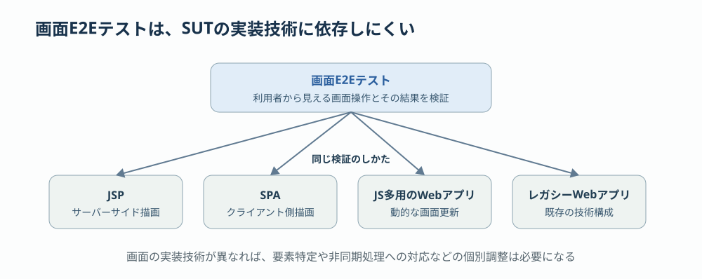

もちろん、画面の実装技術が異なれば、要素特定や非同期処理への対応などの個別調整は必要です。

それでも、アプリケーションの内部構造に強く依存せずに検証できることは、異なる技術スタックの案件を多数抱えるSI企業にとって大きな利点です。

### 8.4. 画面実装方式で変わるテストの選択肢

画面E2Eテストが技術構成を問わず適用できる一方で、E2E以外にどのようなテスト手段を持てるかは、画面の実装方式によって大きく異なります。

SPAでは、画面がコンポーネントの集合として構成され、状態管理やデータ取得がフロントエンド側の明確な層に分かれています。加えて、コンポーネントをブラウザなしで描画し、利用者の操作を模擬して検証するテストライブラリ群が整備されています。そのため、サーバーを動かさずに、フロントエンド単体でインテグレーションテストの層を厚くすることが現実的な方策になります。Kent C. Doddsが提唱したTesting Trophyは、この層に最も多くのテストを置く考え方です。[7]

対するJSPでは、画面はサーバー側でHTMLとして組み立てられ、表示ロジックがJSPタグ、EL式、サーブレットやフレームワークの処理と一体になっています。コンポーネントの境界がなく、画面を単体で描画して検証する標準的な手段もありません。画面の振る舞いを確かめるには、サーバー、DB、認証を含めたシステム全体を動かすしかなく、結果として、画面を実際に打鍵して確認するビッグバン型のE2Eテストになりがちです。

これは実装方式に由来する制約であり、ある程度はやむを得ないものです。内部構造を変えられない保守開発案件では、フロントエンド単体のテスト層を後から作ることは容易ではありません。したがって、JSPを中心とする既存案件では、避けられないE2Eテストをいかに安定して繰り返せるようにするか、すなわちE2Eテストの自動化そのものが現実的な方策になります。

一方、SPAの案件では、フロントエンド単体のインテグレーションテストを厚くし、E2Eテストは主要な業務シナリオに絞るという配分が選べます。E2Eテスト自動化の位置づけは、画面実装方式ごとに異なります。

### 8.5. CI/CD成熟度の制約

2022年時点では、組織として共通のCI/CD構築・運用能力が十分に整っていませんでした。

その状況でSeleniumやPlaywrightによるテスト自動化を各案件に導入すると、テストコードの作成に加えて、実行基盤の構築・保守が必要になります。

結果として、テスト自動化による削減効果を得る前に、各案件が新しい技術的負担を抱えることになります。

一方、SaaSであれば、実行環境や実行管理の一部をサービス側に委ねられます。

### 8.6. 2022年の判断

2022年の判断は、ホワイトボックステストの価値を否定したものではありません。

**保守案件が大半を占め、CI/CD基盤が未成熟な状況で、最も広く適用でき、効果を早く得られる施策として画面E2EのSaaS型自動化を選んだ**という判断です。

個別案件で最大の自動化効果を得ることよりも、多様な案件へ横展開できることを重視しました。

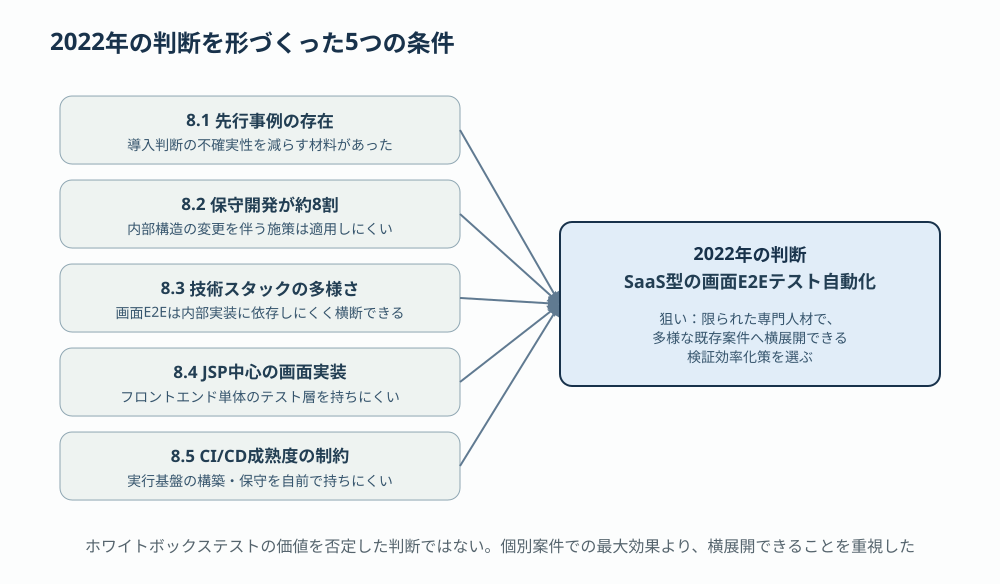

## 9. AIエージェント登場後もMagicPodを推奨する理由

2025年以降、AIエージェントはPlaywrightのテストコード生成・修復を容易にしました。

これにより、従来は専門人材を必要としたTASの実装部分について、参入障壁が低下しています。

しかし、**コードの生成が容易になったことと、TASを安定して運用できることは同義ではありません。**

### 9.1. テスト自動化の専門性の過小評価

AIエージェントによってテストコードを簡単に生成できるようになったことで、テスト自動化そのものも容易になったと捉えられる場合があります。

しかし、これは従来のテスト自動化の専門家が取り組んできた問題を、過小評価する考え方です。

専門家が長年解決してきたのは、単なるスクリプト作成ではありません。

- テストの安定実行
- テストデータの管理
- 実行失敗時の原因切り分け
- SUTの変更への追従
- ブラウザや依存ライブラリの更新
- 実行環境の管理
- テスト結果と証跡の管理
- 継続的な運用体制の整備

特に、テストの失敗がSUTの不具合によるものなのか、テストコードの問題なのか、実行環境の問題なのかを切り分けるには、複数の技術領域にまたがる知識が必要です。

AIエージェントが生成したテストコードが初回に動作したとしても、それだけでは継続運用できるTASを構築できたとはいえません。

**テスト自動化の専門性は、テストを一度動かす技術ではなく、テストを安定して動かし続ける技術にあります。**

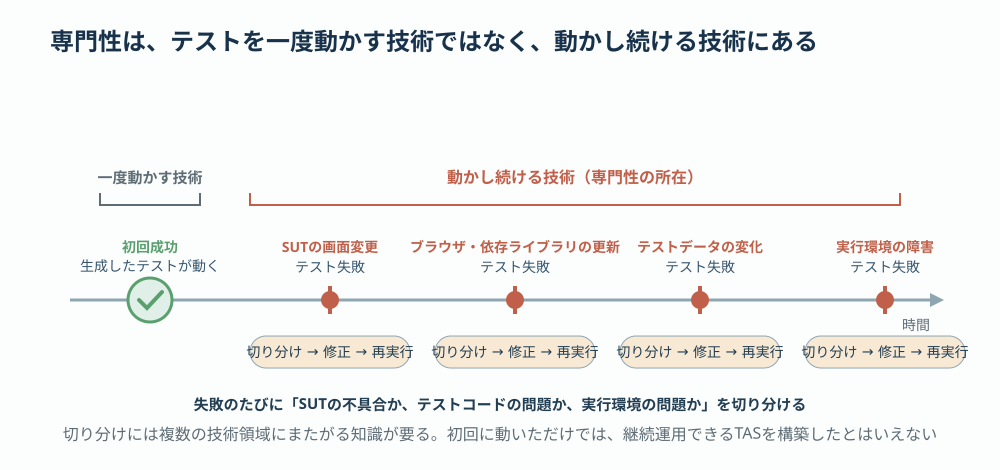

### 9.2. 依然として低いCI/CD成熟度

2022年にMagicPodを選択した理由の一つは、組織のCI/CD成熟度が十分ではなかったことです。

2026年現在も、この構造的な制約は残っています。

AIエージェントによってCI/CD設定ファイルを生成することは容易になりましたが、それだけで組織全体のCI/CD運用能力が向上したわけではありません。

共通の実行基盤、標準設定、運用手順、障害対応体制が整備されていなければ、Playwright＋CI/CDの導入と維持は各案件の責任になります。

各案件に十分な専門人材が配置されていない場合、テスト自動化の導入が新たな属人化を生む可能性があります。

### 9.3. 残存するTASの保守コスト

AIエージェントが削減するのは、主にテスト設計・コード生成・修復に要する作業です。

一方、次のコストは引き続き発生します。

- Runnerの構築・保守
- ブラウザや依存ライブラリの更新
- 認証情報・アクセス権限の管理
- テストデータの管理
- 実行環境の障害対応
- 実行結果の収集・保管
- 継続的なテスト実行の監視

これらの活動をAIで支援することは可能ですが、運用責任そのものがなくなるわけではありません。

### 9.4. 現在もMagicPodを推奨する判断

現在もMagicPodのようなSaaSを推奨する理由は、テストコードの作成が容易だからという理由だけではありません。

**TASの構築・保守・運用に必要な技術的負担を、サービス提供者へ移転できることが重要です。**

AIエージェントによってPlaywrightのテスト実装は容易になりましたが、組織のCI/CD成熟度が変わらない限り、SaaSが持つ運用面の優位性は残ります。

もちろん、すべての案件でSaaSが優位とは限りません。

既存のCI/CDが成熟し、基盤保守を共通チームで引き受けられる案件では、Playwright＋AIエージェントが合理的な選択肢になります。

重要なのは、テストコードを生成するコストだけで比較しないことです。

**評価すべき対象は、継続的にテストを実行し、SUTの変更に追従していくためのTAS全体のコストです。**

## 10. TASの総保有コストに基づくツール選定

自動化ツールを、スクリプトの作りやすさやライセンス料金だけで比較してはいけません。

TASの構築から継続運用までの総保有コスト（TCO）で比較する必要があります。

### 10.1. TASの総保有コスト

TASの総コストは、次のように分解できます。

    TASの総コスト
      = テスト設計・実装費
      + 実行基盤の構築費
      + テスト修復・基盤保守費
      + 定期実行・障害対応費
      + ツール・クラウド利用料

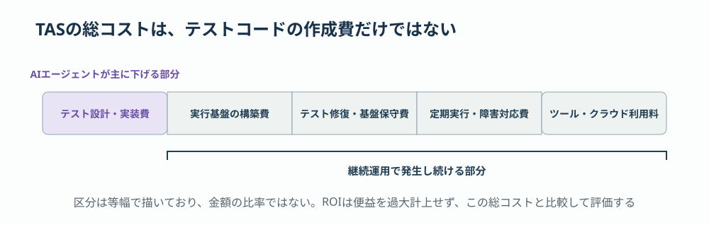

一方、自動化による便益には、次のものがあります。

- 手動テストの実行工数削減
- 回帰テストの実施頻度向上
- 不具合の早期発見
- テスト実行待ち時間の短縮
- リリース判断の迅速化
- 品質の安定化

ROIを評価する場合は、これらの便益を過大計上せず、TASの総コストと比較する必要があります。

### 10.2. 組織の成熟度による選択

| 組織・案件の状態 | 適した選択肢 | 主な理由 |
| --- | --- | --- |
| CI/CD成熟度が低い | ノーコード型SaaS | 実行基盤・運用負担の外部化 |
| 保守開発中心・技術スタックが多様 | ノーコード型SaaS | ブラックボックス型E2Eテストの汎用性 |
| CI/CD基盤が共通化済み | Playwright＋AIエージェント | 既存基盤の再利用 |
| テストコードの高度な制御が必要 | Playwright＋AIエージェント | 実装自由度の高さ |
| 自動化の専門人材が不足 | ノーコード型SaaS | 導入・運用の専門知識への依存低減 |
| テスト基盤を保守する共通チームが存在 | Playwright＋AIエージェント | 基盤保守コストの共通化 |

この比較は一般的な傾向であり、個々の製品機能、契約条件、システム制約によって判断は変わります。

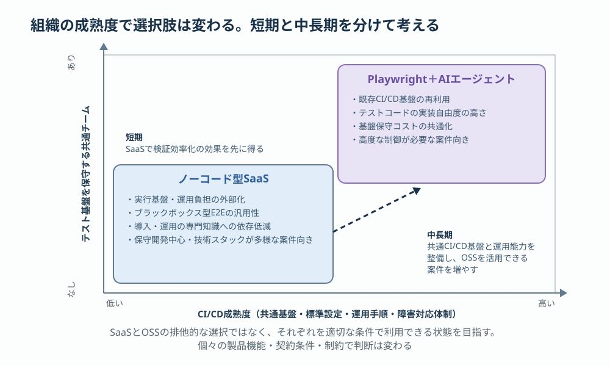

### 10.3. 全社的な推進方針

全社的には、短期的な検証効率化と、中長期的な開発基盤の成熟を分けて考える必要があります。

短期的には、SaaSを用いることで、CI/CD基盤が未成熟な案件でもテスト自動化の効果を得やすくなります。

一方、中長期的には、共通CI/CD基盤や実行環境の標準化を進めることで、PlaywrightなどのOSSを活用できる案件を増やすことができます。

**短期的にはSaaSによって検証効率化の効果を獲得し、中長期的には共通CI/CD基盤と運用能力を整備することが合理的です。**

これはSaaSとOSSを排他的に選択することではなく、それぞれを適切な条件で利用できる状態を目指す方針です。

## 11. 検証の最終課題：正しさの判断根拠

画面テストの歴史は、ブラウザ操作の自動実行から始まり、記録・再生、クラウド実行環境、ノーコード型SaaS、生成AI、AIエージェントへと進化してきました。

その過程で、テストの作成・実行・保守にかかるコストは部分ごとに削減されてきました。

しかし、AIエージェントによってテストコードの生成・修復が容易になっても、TASの継続運用コストがなくなるわけではありません。

さらに、テストが自動的に作成・実行されても、テストの十分性や期待結果の正しさまで自動的に保証されるわけではありません。

SUTの現在の振る舞いだけを根拠に期待結果を作れば、既存の不具合を正しい動作として固定してしまうおそれもあります。

したがって、今後の課題は二層に分かれます。

第一に、TASを安定して運用するための基盤・組織能力を整えることです。

第二に、要件・設計・リスクとテスト観点・期待結果を結び付け、検証の根拠を追跡できるようにすることです。

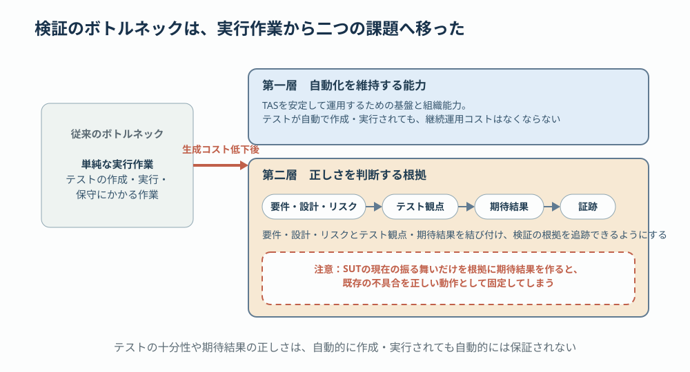

**生成のコストが下がった今、検証のボトルネックは、単純な実行作業から「自動化を維持する能力」と「正しさを判断する根拠」へ移っています。**

---

## 参考資料

1. Selenium Project, *History*  
   https://www.selenium.dev/history/

2. BrowserStack, *About Us*  
   https://www.browserstack.com/company

3. Autify, *Official Global Launch* (2019)  
   https://autify.com/news/launch-platform-globally-d2fe7

4. Playwright, *Release Notes / Test Agents*  
   https://playwright.dev/docs/release-notes  
   https://playwright.dev/docs/test-agents

5. MagicPod, *機能一覧*  
   https://magicpod.com/features/

6. Playwright, *Continuous Integration*  
   https://playwright.dev/docs/ci

7. Kent C. Dodds, *The Testing Trophy and Testing Classifications* (2021)  
   https://kentcdodds.com/blog/the-testing-trophy-and-testing-classifications